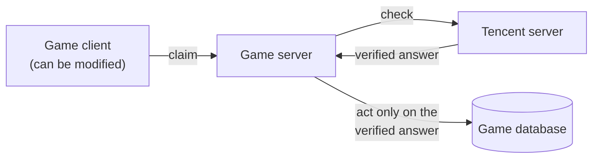
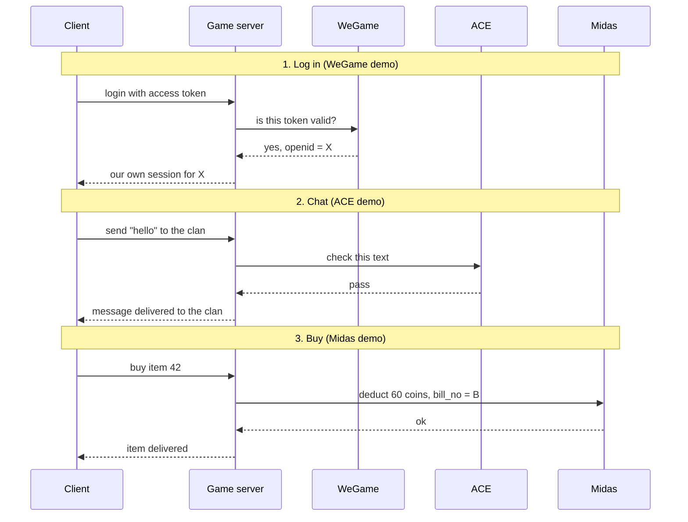

# Tencent Game SDKs: Server-Side Integration Demos

> Small, focused demos of what a **game server** must do to integrate
> Tencent's game SDKs safely: payments (Midas), login (WeGame), and content
> moderation (ACE).

Each demo implements only the core logic and explains the rest with
diagrams. None of them calls a real Tencent API, and none is meant to run.
They show how the problems are reasoned about, not a finished product.

This repository is not affiliated with Tencent. Facts come from Tencent's
public documentation. Anything the public docs do not confirm is marked as
an **assumption** in each demo.

---

## Why these three

They come from a Senior Game Backend Engineer job description:

> *Tencent SDKs: Familiarity with integrating and securing Tencent-specific
> SDKs, including Midas (real-money payments and currency management),
> WeGame (authentication and access tokens), and ACE (anti-profanity and
> content moderation).*

The word that matters is **securing**. All three SDKs live in the game
client. But a game client is in the player's hands: it can be modified,
replayed, or faked. So the real work is on the server.

---

## The one idea behind all three

**The server never takes the client's word for it. It checks with
Tencent's servers.**



| SDK | What a cheating client could claim | What the server does instead |
|---|---|---|
| **WeGame** (login) | "I am player X" | Verifies the access token with WeGame and uses the identity WeGame returns |
| **Midas** (payments) | "I paid 648 CNY" | Gives items only when Midas confirms: a deduct that returned ok, or a signed delivery notice |
| **ACE** (moderation) | "This message is clean" | Sends chat, names and clan names to moderation before anyone else sees them |

---

## How they fit into one player session



Identity comes first: the `openid` that Midas charges and ACE logs is the
one WeGame verified. That is why the order of the demos is WeGame, then
Midas, then ACE, even though Midas was written first.

---

## The demos

| Demo | Status | Core question | Key ideas |
|---|---|---|---|
| [**midas/**](midas/) | Done | How do we charge exactly once and deliver exactly once? | Order state machine, `bill_no` idempotency, "unknown is not failed", one-transaction delivery, crash recovery |
| **wegame/** | Planned | How do we know who the player really is? | Server-side token check, secrets on the server, our own session, expiry |
| **ace/** | Planned | How do we keep bad text out without breaking chat? | Check before showing, what to do when moderation is down (fail open vs fail closed) |

---

## Patterns that repeat across the demos

**Secrets stay on servers.** App keys and secrets sign requests and verify
callbacks. Inside a client they could be extracted, so they never go there.

**A unique key for every action that must happen once.** A payment has a
`bill_no`; a button tap has a `requestId`; a delivery has a row keyed by
`bill_no`. The database's unique constraint, not an "if it exists" check,
is what stops duplicates.

**"Unknown" is its own outcome.** A timeout means "I stopped waiting", not
"it did not happen". Systems that treat timeouts as failures lose money or
double-charge.

**State machines with conditional updates.** Each step moves a row from one
status to the next with `UPDATE ... WHERE status = <old>`. Many processes
can work on the same row, and only one wins each step.

**Decide what happens when the other side is down.** For payments, wait and
retry. For moderation, it depends on the place: a public name can wait, a
chat line may not.

---

## Repository layout

```
tencent-sdk-demos/
  README.md      this overview
  midas/         payments: done
  wegame/        login: planned
  ace/           moderation: planned
```

Each demo has its own README with diagrams, assumptions, and limitations.
Code is TypeScript. Interfaces to Tencent services and to the database are
declared but not implemented; their comments state exactly what each method
must guarantee.
