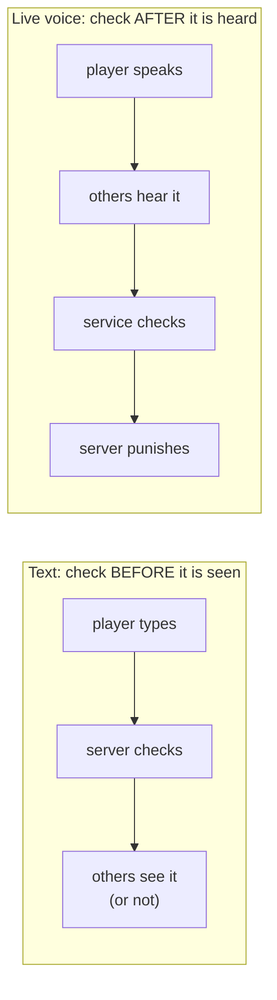
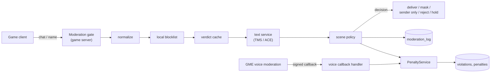
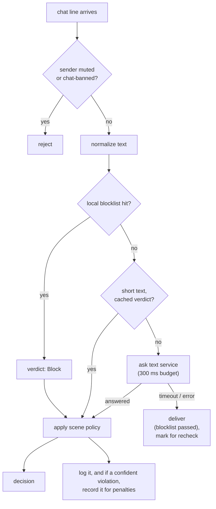
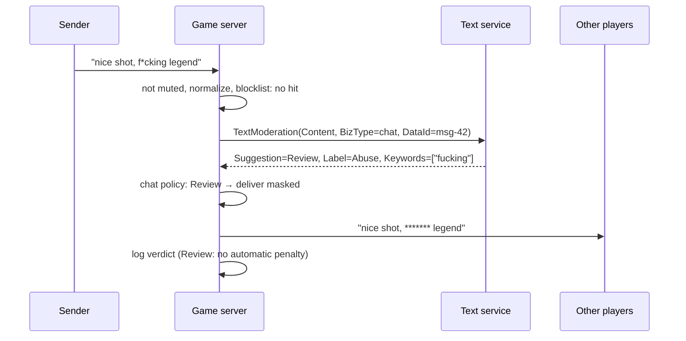
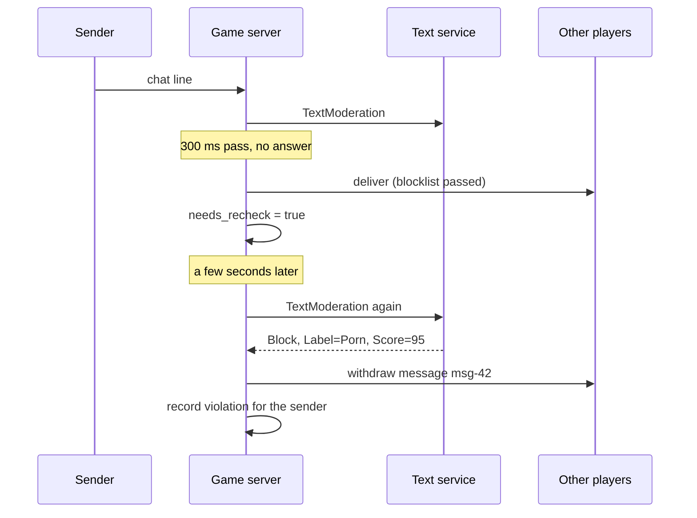
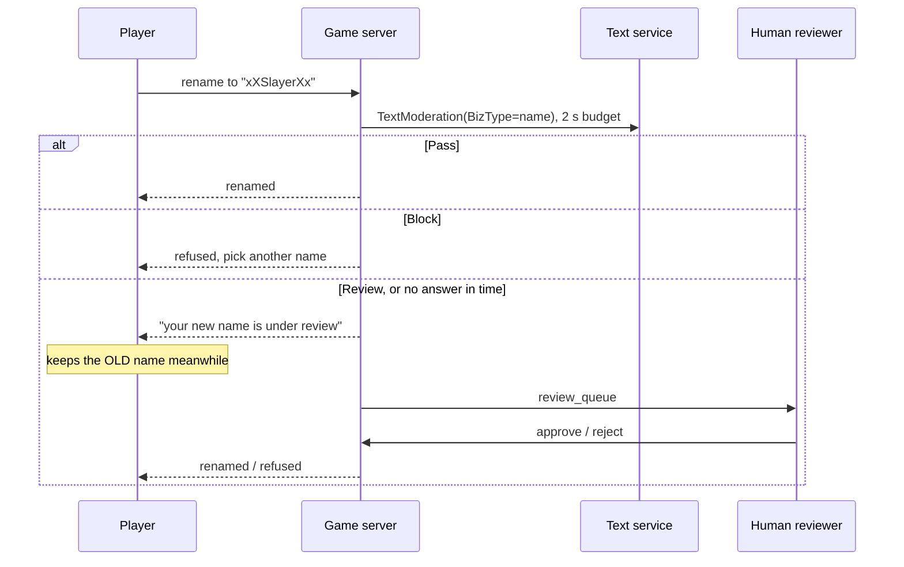
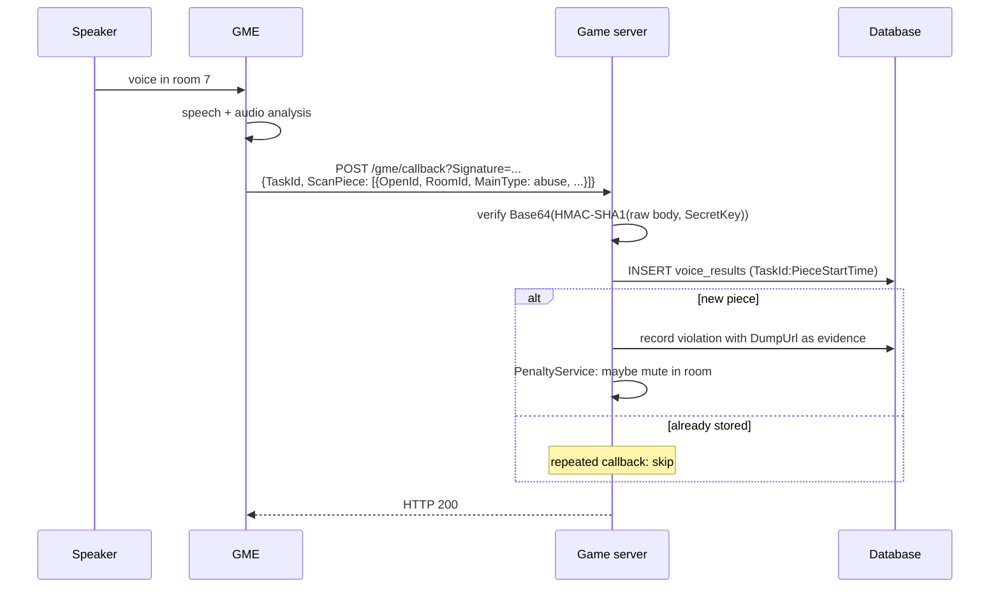
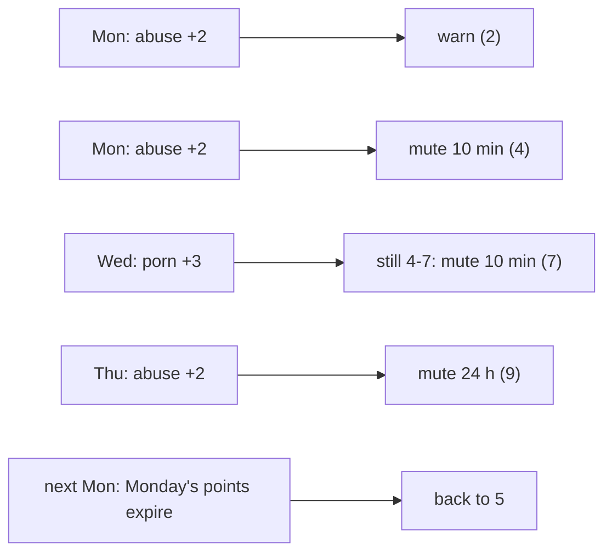
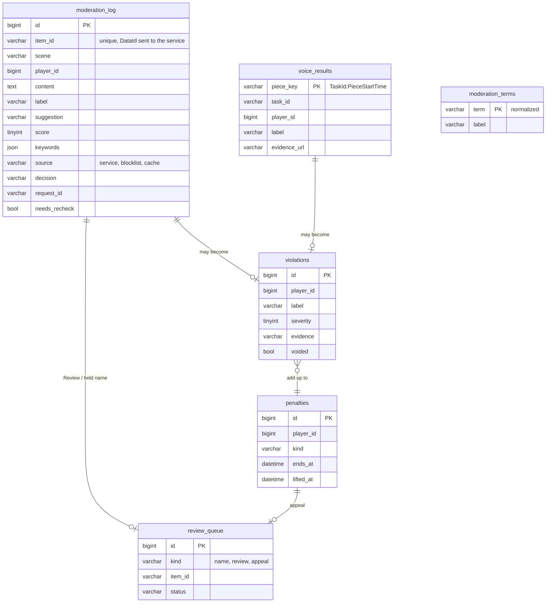
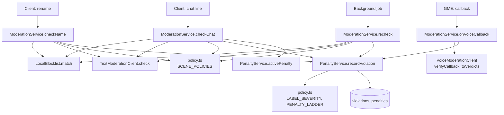

# Content Moderation (ACE): The Server Side

> No chat line or name reaches another player until our server has checked
> it, and every player is judged by the same rules whether they type or
> talk, even when the moderation service is slow or down.

This is a design demo of the **game server's** side of content moderation:
anti-profanity for chat and names, and moderation of voice. It has no
implementation: it defines the data types, the interfaces, the policy
tables and the database, and explains the design with diagrams.

---

## Contents

1. [ACE, and what this demo models](#1-ace-and-what-this-demo-models)
2. [Where bad content shows up](#2-where-bad-content-shows-up)
3. [What the game server has to do](#3-what-the-game-server-has-to-do)
4. [The gate](#4-the-gate)
5. [Checking a chat line](#5-checking-a-chat-line)
6. [Checking a name](#6-checking-a-name)
7. [One policy per scene](#7-one-policy-per-scene)
8. [Voice](#8-voice)
9. [Penalties](#9-penalties)
10. [Cost and quota](#10-cost-and-quota)
11. [Database](#11-database)
12. [The code](#12-the-code)
13. [Security rules](#13-security-rules)
14. [Assumptions and limitations](#14-assumptions-and-limitations)
15. [Sources](#15-sources)

---

## 1. ACE, and what this demo models

**ACE** (Anti-Cheat Expert) is Tencent's game security brand. Best known
for anti-cheat, it also offers a **content moderation** product for games:
detecting abuse, sexual content, advertising and other violations in text
and images. Its API documentation is not public.

Tencent Cloud does publish two moderation APIs that fit a game's needs:

| Content | Public API | How results come back |
|---|---|---|
| Text: chat, names | **TMS `TextModeration`** (`tms.tencentcloudapi.com`, version `2020-12-29`) | In the response, right away |
| Voice: rooms, clips, files | **GME voice content security** (`gme.tencentcloudapi.com`, version `2018-07-11`) | By callback to our server, after the audio is analysed |

This demo defines its interfaces after those two APIs. Whichever product a
game actually uses (ACE, TMS, GME), the game server's job is the same, and
that job is what this demo is about. Treating them as interchangeable is an
**assumption**.

### Words used in this document

| Word | Meaning |
|---|---|
| **verdict** | What the service says about a text or a piece of audio: label, suggestion, score, keywords. |
| **label** | The kind of violation: `normal`, `abuse`, `porn`, `ad`, ... |
| **suggestion** | The service's advice: `Pass`, `Review` (a human should look), `Block`. |
| **decision** | What **we** do: deliver, deliver masked, show only to the sender, reject, hold for a human. |
| **scene** | Where content will be seen: nickname, world chat, whisper, voice room, ... |
| **fail open / fail closed** | When the service cannot answer: let content through / keep it out. |
| **BizType** | A rule set configured in the moderation console. One per scene. |

---

## 2. Where bad content shows up

| Scene | Seen by | Lives | Can we check before others see it? |
|---|---|---|---|
| Nickname, clan name | everyone | until changed | **Yes**, and we must |
| World chat | everyone in the channel | seconds | Yes, but players notice delays |
| Team chat, whisper | a few players | seconds | Yes, same |
| Voice in a room | everyone in the room | instantly | **No**: it is heard as it is spoken |
| Voice message (clip) | the recipients | until played | Yes, before forwarding the clip |



**Text moderation can prevent. Live voice moderation can only punish.**
That one fact shapes the design: text goes through a gate, and voice feeds
the same penalty system so that the punishment is consistent.

---

## 3. What the game server has to do

| # | Job | Why |
|---|---|---|
| 1 | Check every text **on the server**, before delivering it | A client-side filter can be switched off by a modified client |
| 2 | Decide per scene what to do with each verdict | A word that gets a chat line masked should get a name refused |
| 3 | Decide per scene what to do when the service is slow or down | Names can wait; chat cannot |
| 4 | Normalize text and keep a local blocklist | Catches tricks like `ｆ.u.c.k`, and is our fallback |
| 5 | Verify and de-duplicate voice callbacks | The callback URL is public; callbacks may repeat |
| 6 | Turn violations into fair, escalating penalties | One system for text and voice |
| 7 | Keep evidence and allow appeals | Models make mistakes; players need a way back |
| 8 | Control cost and quota | Chat volume is huge and every check costs money |

---

## 4. The gate



Every text goes through the same pipeline. Each stage can end it early:
a muted sender is rejected before anything else, a blocklist hit never
reaches the paid service, a cached verdict skips the network.

---

## 5. Checking a chat line

### The steps



### Happy path



### When the service is slow

Chat cannot wait seconds. If the service does not answer within the
budget, the line goes out on the local blocklist alone, and is checked
again in the background:



The player who sent a bad line during an outage is still caught and
punished; the line is just visible for a few seconds.

### Masking

The text service returns the words that matched. For a `Review` verdict
in chat we replace them with `*` and deliver the rest:

| Original | Keywords | Delivered |
|---|---|---|
| `nice shot, fucking legend` | `fucking` | `nice shot, ******* legend` |
| `buy gold at cheapgold dot com` | `cheapgold` | `buy gold at ********* dot com` |

### Normalization and the local blocklist

Players disguise words. Before matching, the text is normalized:

| Trick | Example | After normalizing |
|---|---|---|
| Full-width letters | `ｆｕｃｋ` | `fuck` |
| Separators | `f.u.c.k`, `f u c k` | `fuck` |
| Zero-width characters | `f​uck` | `fuck` |
| Case | `FuCk` | `fuck` |

The local blocklist (table `moderation_terms`) holds obvious slurs, known
spam domains and game-specific terms. It is matched on the normalized
text, costs nothing, and is our only defence while the service is down.
The service still gets the original text: its models handle context and
disguises far better than a word list.

---

## 6. Checking a name

Names are public and permanent. A bad name is seen by thousands of
players for as long as it exists, so the rules are strict:



The new name is **never shown unchecked**. That is fail closed.

---

## 7. One policy per scene

The same verdict leads to different actions depending on where the content
will be seen. This is the table in [`src/policy.ts`](src/policy.ts):

| Scene | Wait up to | No answer in time | `Review` | `Block` |
|---|---|---|---|---|
| Nickname, clan name | 2 s | **hold** (fail closed) | hold for a human | reject |
| World, team chat, whisper | 300 ms | **deliver on blocklist, recheck** (fail open, check later) | deliver masked | sender only |

**Why fail closed for names and fail open for chat?** Weigh what each
mistake costs:

| | Bad content gets through | Good content is held back |
|---|---|---|
| **Name** | Seen by everyone, for weeks | The player waits a little for a new name |
| **Chat** | Seen by a few, for seconds, then withdrawn and punished | Chat stops working for everyone during an outage |

For names, a wrong "yes" is far worse. For chat, a broken chat during
every outage is worse than a few seconds of exposure that we still catch.

**Why "sender only" for blocked chat?** The sender sees their line as
sent; nobody else sees it. A sender who gets "refused" learns which
spelling trips the filter and tries the next one. A sender who sees
nothing change has nothing to learn from. This is a product choice:
"reject" is the more transparent alternative.

**Each scene uses its own `BizType`** (rule set) in the moderation console,
so names can be stricter than chat without code changes.

---

## 8. Voice

### Live voice in a GME room

Once voice moderation is enabled for the GME app, GME submits room audio
by itself and calls our server when it finds a violation. By default only
violations are sent.



Three things to get right:

1. **Verify the signature on the raw body.** The docs define it as
   `Base64(HMAC-SHA1(POST body, SecretKey))`, sent as the `Signature`
   query parameter. Parsing and re-serializing the JSON first would change
   the bytes and break the check. Without this check, anyone could post a
   fake callback and get any player muted.
2. **De-duplicate.** One row per `TaskId + PieceStartTime`. A callback
   that arrives twice punishes once.
3. **Map the speaker.** `OpenId` in the callback is the user id our game
   gave GME. We map it back to our player.

### Other audio

| Source | How |
|---|---|
| Voice messages (clips) | GME checks them as they are uploaded or transcribed; the game server should forward the clip's file id to recipients only after a clean result. |
| Audio from elsewhere (third-party streams, files) | We call `ScanVoice` with up to 100 tasks, each with our `DataId` and a URL, and a callback URL. Files up to 100 MB / 30 minutes; streams up to 4 hours. |

Both supported languages are Chinese and English.

---

## 9. Penalties

Text and voice violations go to **one** `PenaltyService`. A player muted
for abusive chat should not simply switch to voice.

### Points over a window

Each violation adds points by label (`LABEL_SEVERITY`), counted over the
last 7 days. The highest rung reached applies:

| Points in 7 days | Penalty |
|---|---|
| 2+ | warning |
| 4+ | mute 10 minutes |
| 8+ | mute 24 hours |
| 12+ | chat ban 7 days |
| 20+ | account sent to a human for review |

| Label | Points |
|---|---|
| `ad` | 1 |
| `abuse`, our own terms | 2 |
| `porn`, `moan` | 3 |
| `illegal` | 4 |
| `terrorism`, `politics` | 5 |

**Why points over a window, not "three strikes forever"?** One bad evening
should cool down. A habit should escalate.



### Only confident verdicts punish

A verdict counts toward penalties only if the service was confident
(`score >= 80`) and said `Block`. A `Review` verdict changes what others
see (masked, or held), but never punishes automatically: a human decides.

### Evidence and appeals

Every violation keeps its evidence: the logged text with the service's
`RequestId`, or the voice piece's `DumpUrl`. A player can appeal; a human
reviews from `review_queue`; a won appeal sets `voided` on the violation
and lifts the penalty, and both stay in the history.

A preview build of *Squad*'s China edition was reported to warn players
about team kills in tiers and to let victims report deliberate team kills
([游戏日报 via Sohu, 2026-05-28](https://www.sohu.com/a/1028663636_118576)).
A per-player history that drives escalating consequences, as above, is the
backend such features need. How the real game implements them is not
public.

---

## 10. Cost and quota

Every call to the text service costs money and uses quota (default 1000
requests per second per account). Chat produces far more lines than that
at peak.

| Measure | Effect |
|---|---|
| **Local blocklist first** | Obvious violations never reach the service |
| **Verdict cache** for texts of 32 characters or less, 10 minutes | "gg", "nice", "go go go" are checked once, not a million times |
| **No cache when context is attached** | With context, the same words can mean different things |
| **Muted senders rejected first** | No calls for players who cannot chat anyway |

---

## 11. Database



Full SQL: [`sql/schema.sql`](sql/schema.sql).

| Table | Guarantees |
|---|---|
| `moderation_log` | Every check is recorded with the service's `RequestId`: we can always explain a decision. `needs_recheck` finds lines that went out during an outage. |
| `voice_results` | Primary key `TaskId:PieceStartTime`: a repeated callback punishes once. |
| `violations` | The only input to penalty points. `voided` undoes one without deleting history. |
| `penalties` | Current and past punishments; lifted ones keep who and when. |
| `review_queue` | `UNIQUE (kind, item_id)`: an item is queued once. |
| `moderation_terms` | The local blocklist, editable without a deploy. |

---

## 12. The code

There is no implementation, only definitions with comments that state
exactly what each part must do.

```
sql/
  schema.sql      the six tables
src/
  types.ts        Scene, Label, Verdict, Decision, Penalty, VoiceCallback
  policy.ts       SCENE_POLICIES, LABEL_SEVERITY, PENALTY_LADDER, cache rules
  clients.ts      TextModerationClient, VoiceModerationClient
  moderation.ts   ModerationService (the gate), PenaltyService, LocalBlocklist
```



**Reading order:** `types.ts` (verdict vs decision) → `policy.ts` (the
tables that make every decision) → `moderation.ts` (the gate's steps) →
`clients.ts` and `sql/schema.sql`.

---

## 13. Security rules

- **The server is the only gate.** Clients never send chat or names
  directly to other clients.
- **Moderation credentials stay on servers.** Both APIs are signed with
  our Tencent Cloud keys.
- **Verify every voice callback's signature, on the raw body.**
- **De-duplicate callbacks** before punishing.
- **Names fail closed.** An unchecked name is never shown.
- **Only confident `Block` verdicts punish automatically.** Everything
  else goes to a human.
- **Keep evidence, allow appeals.** Never delete a violation; void it.
- **Send the service only what it needs:** the text, our message id, and a
  session id for context.

---

## 14. Assumptions and limitations

**From public docs:** the `TextModeration` endpoint, version, input
(`Content` base64, `BizType`, `DataId` max 64 chars, `SessionId`), output
(`Suggestion` Pass/Review/Block, `Label`, `SubLabel`, `Score` 0-100,
`Keywords`, `RequestId`), the 10,000-character limit, Chinese/English
support, the 1000 req/s default; GME's `ScanVoice` and
`DescribeScanResultList`, task and file limits, voice labels, callback by
POST with `Signature = Base64(HMAC-SHA1(body, SecretKey))`, HTTP 200 as
success, "violations only" by default.

**Assumed:**

- **ACE's own content moderation API behaves like TMS/GME.** Its docs are
  not public.
- **Text labels beyond Normal, Porn, Abuse, Ad.** The docs' examples also
  show `Illegal`, `Terror`, `Polity` and others without defining them;
  unknown labels map to `other`.
- **Voice callbacks may be delivered more than once.** The docs do not
  state a retry policy; de-duplication costs little and is safe either way.
- **The query parameter name.** The callback page writes `Signature`; the
  `ScanVoice` page writes `Signatue`. Accept the documented one, and check
  which one actually arrives during integration.
- **No replay protection beyond de-duplication.** The callback carries no
  timestamp to check freshness.
- **Thresholds** (300 ms, 2 s, score 80, the point ladder, cache size) are
  starting values to tune with real data.

**Limitations:**

- **Live voice is punished, not prevented.** Nothing can un-hear it.
- **A few seconds of exposure during outages** for chat, by design.
- **Images and UGC** (custom sprays, map names) are not covered.
- **Only Chinese and English** are supported by the voice service, and
  English text moderation needs a ticket to confirm.
- **Human review tooling** is assumed, not designed.

---

## 15. Sources

- [ACE: content moderation product page](https://intl.anticheatexpert.com/products/content-moderation)
- [TMS: TextModeration API](https://cloud.tencent.com/document/product/1124/51860)
- [GME: voice content security overview](https://cloud.tencent.com/document/product/607/77646)
- [GME: real-time voice moderation](https://cloud.tencent.com/document/product/607/59173)
- [GME: voice message moderation](https://cloud.tencent.com/document/product/607/64859)
- [GME: third-party stream / file moderation](https://cloud.tencent.com/document/product/607/64860)
- [GME: callback specification](https://cloud.tencent.com/document/product/607/64861)
- [GME: ScanVoice API](https://cloud.tencent.com/document/product/607/37622)
