# Midas Payment Integration: The Server Side

> A player pays, and gets exactly what they paid for: **never charged
> twice, never charged without the item, never given an item for free**,
> even when Midas times out, our server crashes, or a notice arrives twice.

This is a design demo of the **game server's** side of Tencent's Midas
payment platform. It implements the core order flow (about 200 lines of
TypeScript) and explains the rest with diagrams. It does not call any real
Tencent API and is not runnable.

---

## Contents

1. [What Midas is](#1-what-midas-is)
2. [What the game server has to do](#2-what-the-game-server-has-to-do)
3. [The order state machine](#3-the-order-state-machine)
4. [Flows](#4-flows)
5. [Database](#5-database)
6. [The code](#6-the-code)
7. [Security rules](#7-security-rules)
8. [Assumptions](#8-assumptions)
9. [Known limitations](#9-known-limitations)
10. [Sources](#10-sources)

---

## 1. What Midas is

Midas (米大师) is the payment platform used across Tencent games. Whether a
player pays with WeChat Pay, QQ Wallet, or Apple's in-app purchase, the
payment goes through Midas. The game does not deal with each payment
channel itself.

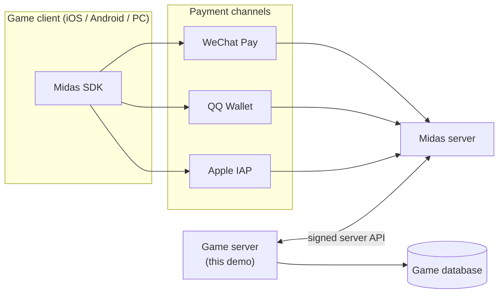

**Platform differences are hidden by Midas.** On iOS the money is taken by
Apple; on Android by the channel the player picks. The Midas SDK and the
Midas server handle that. The game server sees the same API on every
platform. The one thing it must pass along is `pf`, the platform/channel
info from login.

### Two pay modes

A game picks a mode per product in the Midas console.

**Hosted game coins.** The player's coin balance is kept **by Midas**, like
a bank account Midas runs for the game.

> A player tops up 60 CNY and gets 600 coins. Midas records a balance of
> 600. Later they buy a 60-coin skin: the game server asks Midas to deduct
> 60, Midas says ok, and the game server gives the skin.

**Direct buy.** No coins in between. The player pays real money for the
item itself.

> A player pays 30 CNY for a bundle in the client. When the payment is
> done, Midas calls the game server: "this player paid for the bundle,
> please deliver". The game server delivers and answers "success".

The difference is **who makes the next move**:

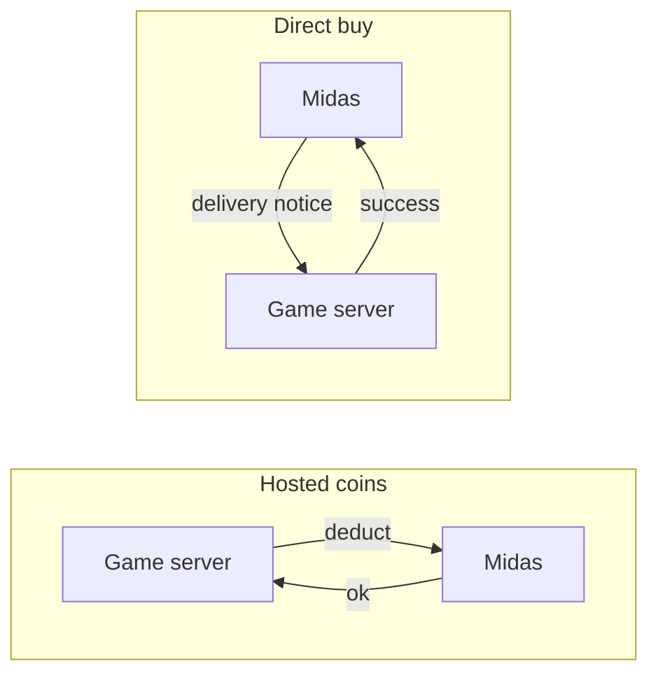

### Words used in this document

| Word | Meaning |
|---|---|
| **openid** | The player's account id, given by the login (WeChat or QQ). |
| **openkey, pfkey** | The player's login tickets. Midas needs them to act on the player's account. Short-lived. |
| **pf** | Platform and channel info from login, for example which store and which OS. |
| **offerid** | The game's payment id, issued by Midas. |
| **zoneId** | Which game zone the coins belong to. With roles: `zone_role`. |
| **AppKey** | The game's secret key from Midas. Used to sign requests. Server only. |
| **bill_no** | Our order number. Sent with every deduct; Midas uses it to avoid charging twice. |
| **deduct** | Take coins from the player's hosted balance. |
| **cancel deduct** | Give those coins back. |
| **delivery notice** | Midas calling our server to say a direct-buy order was paid. |
| **deliver** | Give the item to the player in our own database. |
| **idempotent** | Doing it twice has the same effect as doing it once. |

---

## 2. What the game server has to do

The client shows the shop, opens the payment UI, and handles SDK callbacks.
**None of that decides whether an item is given.** The server's jobs are:

| # | Job | Why |
|---|---|---|
| 1 | Keep the AppKey and sign every Midas request | In a client, the key could be extracted and used to forge requests |
| 2 | Create an order with a unique `bill_no` before paying | Retries, refunds and reconciliation all hang on this id |
| 3 | Hosted coins: call deduct, and cancel when delivery is impossible | The server decides when money moves |
| 4 | Direct buy: verify and handle Midas's delivery notice | The notice URL is public, and Midas may send the same notice again |
| 5 | Treat "unknown" results correctly | A timeout does not mean the money did not move |
| 6 | Reconcile against Midas's records | Find orders where money moved but no item was given |

---

## 3. The order state machine

Every order is a row in `purchase_orders`. Its status says exactly where it
stopped, so any process can pick it up after a crash.

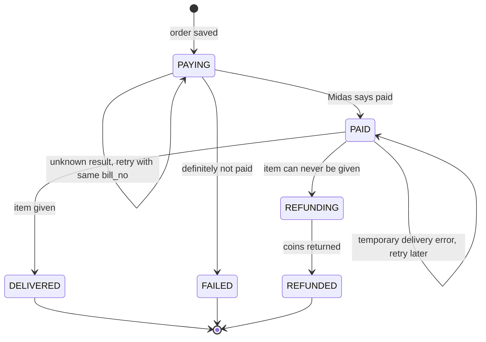

| Status | Money | Item | After a crash, we... |
|---|---|---|---|
| `PAYING` | unknown | no | retry deduct with the same `bill_no` |
| `PAID` | taken | no | deliver |
| `DELIVERED` | taken | given | nothing (final) |
| `FAILED` | not taken | no | nothing (final) |
| `REFUNDING` | taken | no | retry cancel |
| `REFUNDED` | returned | no | nothing (final) |

### Three rules

**1. Save first, then call Midas.** The order is written as `PAYING`
before the deduct call. If we crash right after the call, the row is how we
find the order again.

**2. "Unknown" is not "failed".** On a timeout or "system busy", the order
**stays `PAYING`**. Marking it failed when the coins were in fact taken
would take the player's money for nothing.

**3. Only refund when delivery is truly impossible.** A deadlock is
temporary: stay `PAID` and retry. A deleted item is permanent: refund.
Refunding on a temporary error could give the player both the item (on a
later retry) and their money back.

### Every path uses the same engine

`advance(billNo)` reads the order, takes the next step for its status, and
repeats until it cannot go further. The buyer's request, the delivery
notice, and the recovery jobs all call it. It is safe to run many times, in
many processes at once:

- Midas deducts once per `bill_no`, so repeating a deduct is safe.
- Every status change is `UPDATE ... WHERE status = <old>`. Only one caller
  can win each move; the others see 0 rows changed and simply reload.
- Delivery inserts into `item_grants` keyed by `bill_no`. A second insert
  fails, so an item is never given twice.

### One order, start to finish

Here is one order that hits almost every problem, told as a story. The
player Li has 600 hosted coins and buys a 60-coin skin.

| Time | What happens | Order status | Li's coins | Skin |
|---|---|---|---|---|
| 10:00:00.0 | Li taps "buy". The client sends `requestId = R1`. | | 600 | no |
| 10:00:00.1 | Li's phone lags, so Li taps again. Same `R1` arrives a second time. | | 600 | no |
| 10:00:00.2 | The server looks up the price (60) and saves order `X` as `PAYING`. The second request hits the unique key on `(openid, R1)` and is handed order `X` too. | `PAYING` | 600 | no |
| 10:00:00.3 | The server asks Midas to deduct 60 for `X`. Midas deducts, but the reply is lost. The server sees a timeout. | `PAYING` | 540 | no |
| 10:00:00.6 | Unknown result, so the order stays `PAYING`. The server retries with the **same** `X`. Midas answers "duplicate bill_no": it already deducted. | `PAID` | 540 | no |
| 10:00:00.7 | The server tries to deliver. The database has a deadlock and the transaction fails. The request returns "processing" to Li. | `PAID` | 540 | no |
| 10:01:00 | The recovery job finds `X` stuck in `PAID` and delivers it in one transaction. | `DELIVERED` | 540 | yes |

Li tapped twice, Midas timed out, and the database failed once. Li still
paid 60 exactly once and got the skin exactly once.

---

## 4. Flows

### 4.1 Buying with hosted coins (happy path)

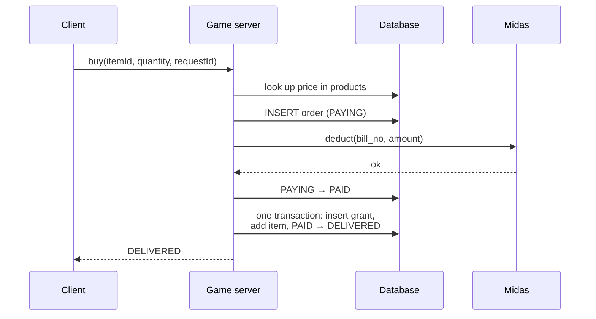

### 4.2 Midas times out

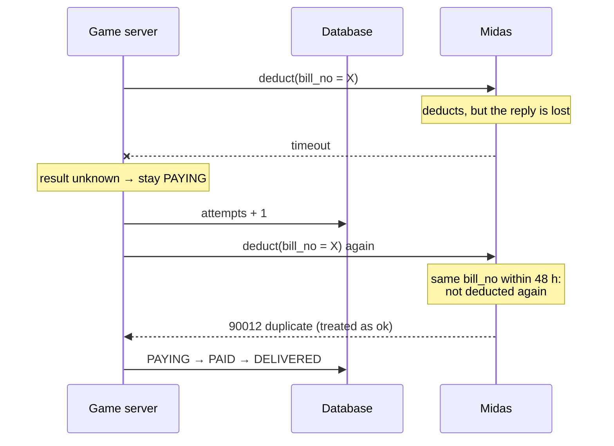

### 4.3 The player taps "buy" twice

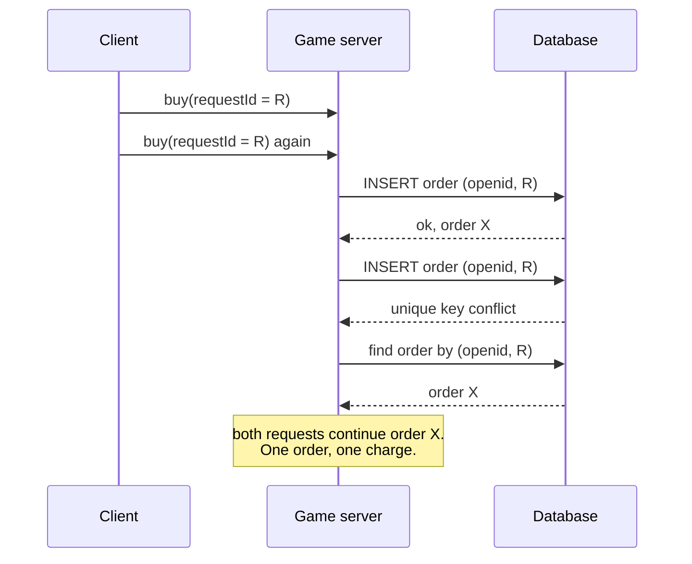

### 4.4 Paid, but the item can never be given

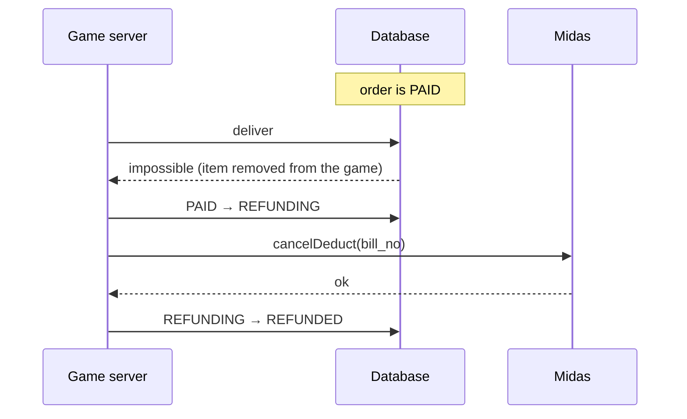

### 4.5 Direct buy: Midas's delivery notice

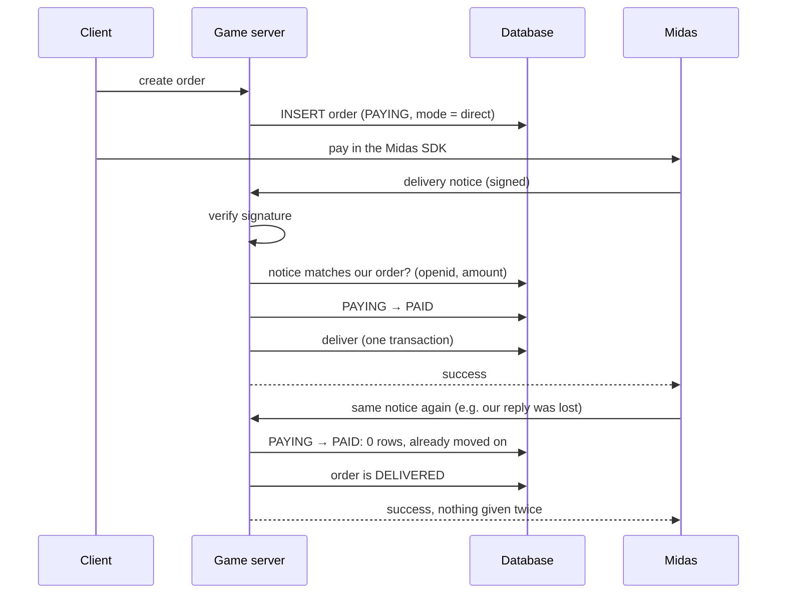

We deliver what **our own order** says. The notice must agree with it; a
signed but inconsistent notice raises an alert and delivers nothing.

### 4.6 Recovery after a crash

Two jobs finish orders a crash left behind:

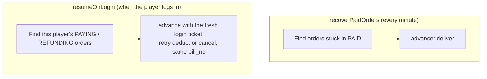

**Why two jobs?** Deducting and refunding act on the player's Midas account
and need the player's login ticket (`openkey`, `pfkey`). Tickets are like
short-lived passwords, so we never store them. A `PAID` order needs nothing
from Midas and can be finished any time. `PAYING` and `REFUNDING` orders
wait until the player logs in again and we have a fresh ticket.

**Retry window.** Midas promises "same `bill_no`, deducted once" for 48
hours. After that, a retry could charge twice. So a deduct is retried only
within 24 hours of the order; older `PAYING` orders go to a human to settle
against Midas's records.

---

## 5. Database

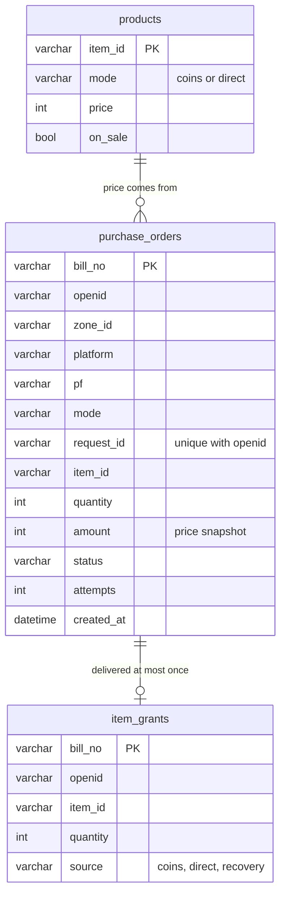

Full SQL: [`sql/schema.sql`](sql/schema.sql).

| Table | Guarantees |
|---|---|
| `products` | The price is decided by the server. The client can only name an item. |
| `purchase_orders` | Every order's progress is recorded, so a crash loses nothing. `UNIQUE (openid, request_id)` stops a double tap from making two orders. `amount` is a snapshot, so a later price change never makes retries or refunds disagree. |
| `item_grants` | `bill_no` is the primary key: whichever path delivers (coins, direct notice, recovery), an order is delivered once. It is also what we reconcile against Midas's records. |

Delivery is one transaction:

```sql
BEGIN;
  INSERT INTO item_grants (bill_no, ...) VALUES (?, ...);  -- fails if delivered before
  UPDATE player_inventory SET count = count + ? WHERE ...; -- the game's own table
  UPDATE purchase_orders SET status = 'DELIVERED'
   WHERE bill_no = ? AND status = 'PAID';
COMMIT;
```

Taking an item off sale (`on_sale = false`) blocks **new** orders only.
Orders already paid are still delivered: the item was on sale when the
player paid.

---

## 6. The code

```
sql/
  schema.sql     the three tables
src/
  types.ts       Order, OrderStatus, PurchaseRequest, Product
  db.ts          Db interface: every method lists the SQL it stands for
  midas.ts       MidasClient interface: deduct, cancelDeduct, verifyNotice, ...
  order.ts       createOrder, purchase, advance, deliver   ← the core
  notice.ts      onDeliveryNotice                           (direct buy)
  recovery.ts    recoverPaidOrders, resumeOnLogin           (after crashes)
```

**Suggested reading order:**

1. `sql/schema.sql`: what we store, and which keys protect us.
2. `src/types.ts`: the six statuses.
3. `src/order.ts`: start at `advance`. It is the whole state machine in
   one `switch`. Then read `pay`, `deliver` and `refund`, one per status.
4. `src/notice.ts` and `src/recovery.ts`: other ways into `advance`.
5. `src/db.ts` and `src/midas.ts`: the contracts the core relies on.

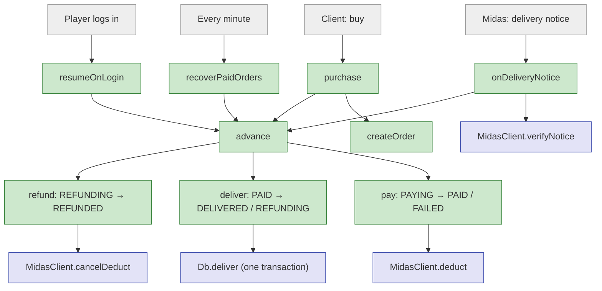

Green: implemented. Blue: interface only, with comments that state the
contract. Grey: outside this demo.

---

## 7. Security rules

- **The client never decides that a payment succeeded.** The SDK's
  "payment success" callback only updates the UI. Items are given only on a
  server-side result: a deduct that returned ok, or a notice whose signature
  checks out.
- **The client never sends a price.** `PurchaseRequest` has no price field.
  The server multiplies its own price by a validated, positive, whole
  quantity.
- **The AppKey lives only on servers.** It signs our requests and verifies
  Midas's notices.
- **The player's identity comes from the verified login**, not from a field
  the client fills in. (Verifying the login is the subject of the WeGame
  demo.)
- **Login tickets are never stored.** They are passed through for the one
  call that needs them.
- **A notice is checked against our own order.** We deliver what we sold,
  not what a notice says.

---

## 8. Assumptions

Midas's server documentation is internal (the MSDK page links to
`unipay.boss.com`, which is not public). The facts used here come from the
public MSDK client docs and the public WeChat mini-game Midas docs, which
belong to the same Midas system but use different endpoint names.

**From public docs:**

- The two pay modes, and that coin balances can be hosted by Midas.
- Client parameters: `offerid`, `openid`, `openKey`, `pf`, `pfKey`,
  `zoneId` (`zone_role` when roles are used), `env` = `test` / `release`.
- `bill_no`: at most 63 characters, letters, digits and `-`.
- Same `bill_no` within 48 hours is deducted only once; on a timeout or
  `-1`, retry with the same `bill_no`.
- Error codes `-1`, `90012`, `90013`, `90016`, `90018`.
- Deduct, cancel deduct, and present coins exist as server APIs.
- The SDK reports delivery failure code `10001` as "needs reissue".

**Assumed (not confirmed by public docs):**

- `90012` (duplicate `bill_no`) on a retry means an earlier try succeeded.
  A safer implementation would confirm with an order query API.
- Cancel deduct is safe to repeat for the same `bill_no`.
- Coin balances may be kept per platform, which is why `pf` must be stored
  and reused exactly.
- The delivery notice's parameter names (`billno`, `openid`, `amt`), its
  reply format, and its signing algorithm. `verifyNotice` hides these.
- How refunds for direct-buy orders are done. This demo leaves them to
  support staff.

---

## 9. Known limitations

- **Orders stuck too long need a human.** A `PAYING` order older than the
  retry window, a refund Midas rejects, or an order with many attempts
  should raise an alert. The alerting itself is not shown.
- **No reconciliation job.** In production, a daily job compares
  `item_grants` and our orders with Midas's transaction records. This demo
  gives it the data it needs but does not include it.
- **PAYING orders wait for the player.** Without a stored ticket, an order
  whose deduct result is unknown is only finished when the player logs in
  again (or by a human).
- **The database is a single source of truth.** Its availability and
  backups are assumed.
- **Present coins and balance queries** are in the interface but not used:
  they have no consistency problems worth showing.

---

## 10. Sources

- [MSDK Wiki: Midas iOS integration](https://wiki.ssl.msdk.qq.com/IOS/midas.html)
- [WeChat mini-game: deduct game coins (`pay_v2.pay`)](https://developers.weixin.qq.com/minigame/dev/api-backend/midas-payment/game_currency/api_pay_v2.pay.html)
