# WeGame Login Integration: The Server Side

> A player is let into the game only when **WeGame** says who they are,
> that they own the game, and that they are not banned. The game client's
> word is never enough.

This is a design demo of the **game server's** side of WeGame login. It has
no implementation: it defines the data types, the interfaces, the decision
tables and the database tables, and explains the design with diagrams.

Every endpoint, parameter and error code below comes from WeGame's public
developer docs (see [Sources](#13-sources)). Anything the docs do not say
is marked as an **assumption**.

---

## Contents

1. [What WeGame is](#1-what-wegame-is)
2. [Three kinds of token](#2-three-kinds-of-token)
3. [What the game server has to do](#3-what-the-game-server-has-to-do)
4. [Our server's credential: the access_token](#4-our-servers-credential-the-access_token)
5. [Player login](#5-player-login)
6. [What every result code means](#6-what-every-result-code-means)
7. [Ownership and bans](#7-ownership-and-bans)
8. [Our own session](#8-our-own-session)
9. [Database](#9-database)
10. [The code](#10-the-code)
11. [Security rules](#11-security-rules)
12. [Assumptions and limitations](#12-assumptions-and-limitations)
13. [Sources](#13-sources)

---

## 1. What WeGame is

WeGame is Tencent's PC game platform: a store and launcher, like Steam.
Games on it use the **WeGame SDK** (also called **RailSDK**) in the client,
and the **WeGame Web API** from their servers.

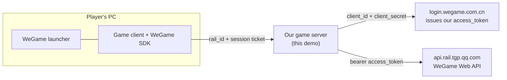

Every player has a **rail_id** for each game: a 64-bit number, assigned
when they activate the game, unique within that game, and never changed.

The Web API covers much more than login: anti-cheat (ban, unban, report),
ownership and DLC, items, in-game purchase, dirty-word filtering,
leaderboards, friends, and game zones. This demo covers the part every
online game needs first: **knowing who the player is**.

---

## 2. Three kinds of token

The word "token" means three different things here. Mixing them up is the
most common source of confusion.

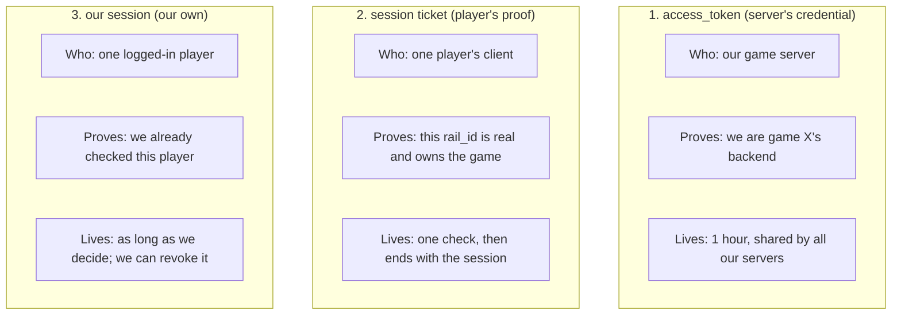

| | access_token | session ticket | our session |
|---|---|---|---|
| Issued by | WeGame login server | WeGame SDK in the client | our game server |
| Held by | our servers only | the player's client | the player's client |
| Sent to | every Web API call | our login endpoint, once | every later request to us |
| Checked by | WeGame | WeGame, via `auth_ticket` | us, in our database |
| If stolen | attacker can call Web API as us | one login (it is single-use) | attacker acts as that player until it expires or we revoke it |

The job description's phrase "Authentication and Access Tokens" maps onto
the first two.

---

## 3. What the game server has to do

| # | Job | Why |
|---|---|---|
| 1 | Keep `client_secret` on servers and fetch the `access_token` | Inside a client, the secret could be extracted |
| 2 | Share one `access_token` across all servers, refreshed by one of them | A new token kills the previous one within 5 minutes |
| 3 | Verify every login's session ticket with `auth_ticket` | The client's `rail_id` is just a claim |
| 4 | Check ownership and ban status | A valid ticket does not by itself mean "allowed to play" |
| 5 | Turn each result code into a clear decision | Some codes mean "no", some mean "ask again later" |
| 6 | Issue and manage our own session | Tickets are single-use and the API is rate-limited |
| 7 | Log every attempt | To spot abuse and tune rate limits |

---

## 4. Our server's credential: the access_token

### How to get one

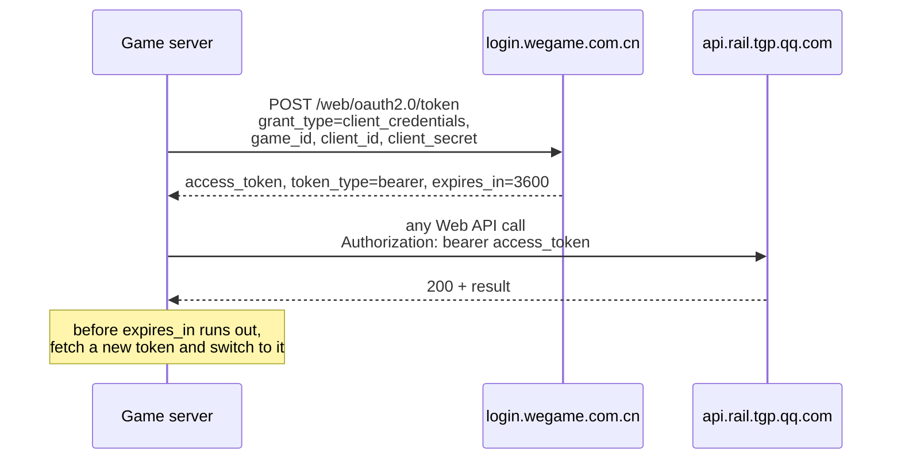

`client_id` and `client_secret` are created in the WeGame developer portal
(Game → Technical config → Web-API → Credentials). Each Web API must also
be granted to that credential in the portal.

Two facts from the docs drive the whole design:

1. The token lives `expires_in` seconds. It is 3600 today, but the docs say
   this may change, so **always read `expires_in`**.
2. **Requesting a new token makes the previous one stop working within
   5 minutes.**

### The trap: every server refreshing on its own

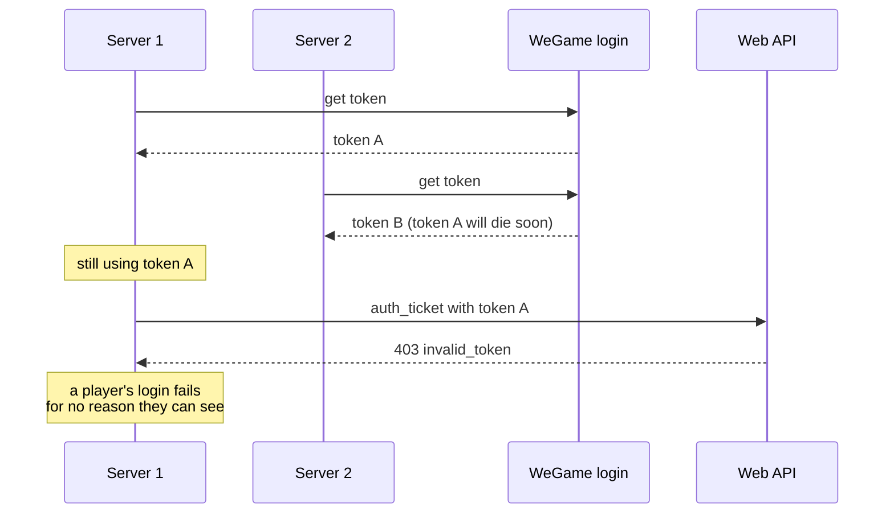

With 20 servers each refreshing hourly, some server's token dies every few
minutes. Logins fail at random, and the cause is hard to find because each
server's own logic looks correct.

### The fix: one refresher for the whole fleet

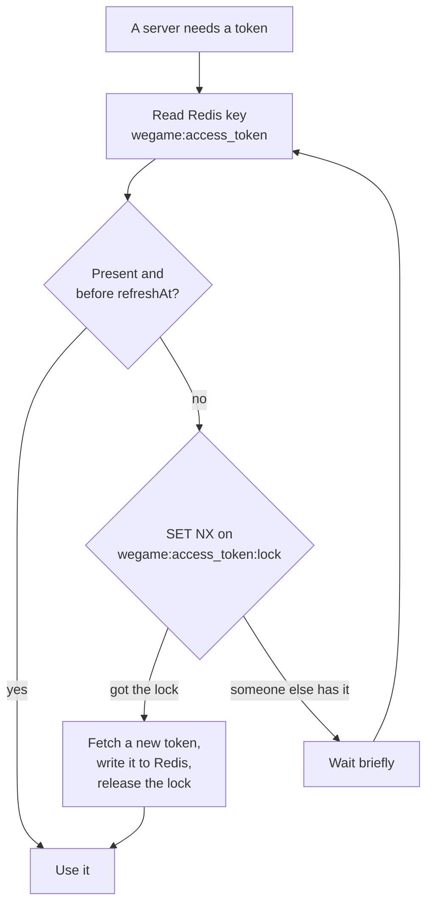

1. **One shared copy.** All servers read the token from Redis.
2. **One refresher at a time.** Only the server holding a short lock may
   fetch a new token.
3. **Refresh early.** At 80% of the lifetime (`refreshAt`), not at the last
   second. Everyone keeps using the current token meanwhile.
4. **Handle 403 without a stampede.** When a call returns 403
   `invalid_token`, the server calls `invalidate(badToken)`. It refreshes
   only if Redis **still holds that same bad token**. If 20 servers hit 403
   at once, the first one refreshes and the other 19 find a new token
   already there.

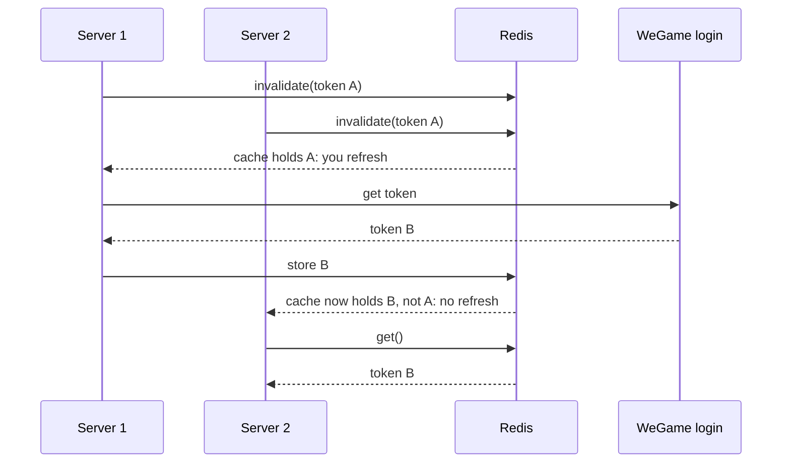

### HTTP status codes from the Web API

| Status | Meaning | What we do |
|---|---|---|
| 200 | Auth passed | Read `result` in the body |
| 400 | Bad parameters | Our bug: alert |
| 403 | URL not granted, or token invalid | `invalidate`, then retry once |
| 404 | Bad URL | Our bug: alert |
| 500, 502 | WeGame error | Retry later |
| 503 | Rate limited | Retry later, slower |

---

## 5. Player login

### The happy path

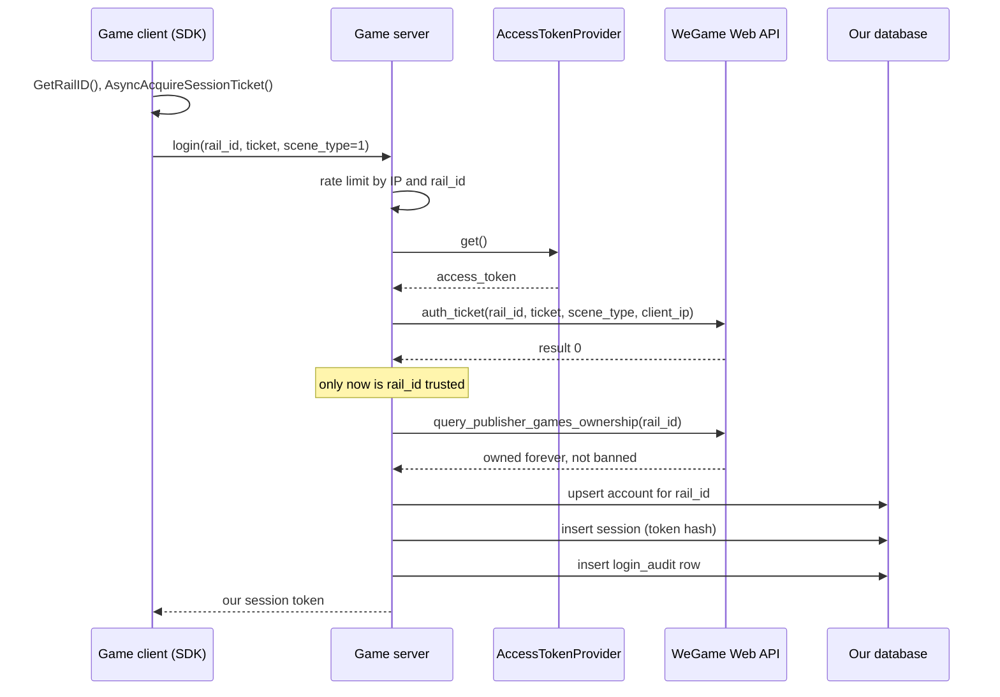

The steps, in words:

1. **Client gets a ticket.** The SDK call `AsyncAcquireSessionTicket`
   returns a fresh session ticket. The client sends it with its `rail_id`.
2. **Rate limit.** Per IP and per `rail_id`. This protects WeGame's quota
   (code `11509`) and slows down anyone guessing tickets.
3. **Verify the ticket.** `auth_ticket` checks that the ticket is real,
   unexpired, not cancelled, and **belongs to that `rail_id`** (code `11502`
   is "ticket belongs to someone else"). Before result `0`, the `rail_id` is
   only a claim.
4. **Check ownership and bans.** See [section 7](#7-ownership-and-bans).
5. **Find or create the account.** One row per `rail_id`.
6. **Issue our own session.** See [section 8](#8-our-own-session).
7. **Audit.** One row in `login_audit`, whatever happened.

### `client_ip` comes from the connection

`auth_ticket` takes the player's IP. We send the address **we see on the
connection** (or from a trusted proxy header we set ourselves), never a
value the client puts in its request. WeGame can use the IP to judge the
login environment (code `2150059`, "abnormal login environment").

### Reconnecting

After a dropped connection, the client gets a **new** ticket and logs in
with `scene_type = 2`. A ticket can be checked only once, so the old one
cannot be reused. If the player still holds a valid session of ours, the
game can skip WeGame entirely for a short reconnect window.

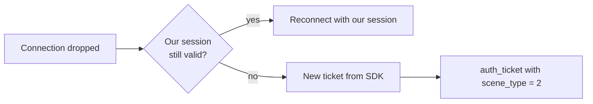

### Logging out

The server revokes our session. The client also calls the SDK's
`AbandonSessionTicket`, so WeGame stops treating the ticket as live.

---

## 6. What every result code means

`auth_ticket` answers `result: 0` for a valid ticket and a non-zero code
otherwise. Each code must lead to a clear decision. The decision table is
[`src/errors.ts`](src/errors.ts):

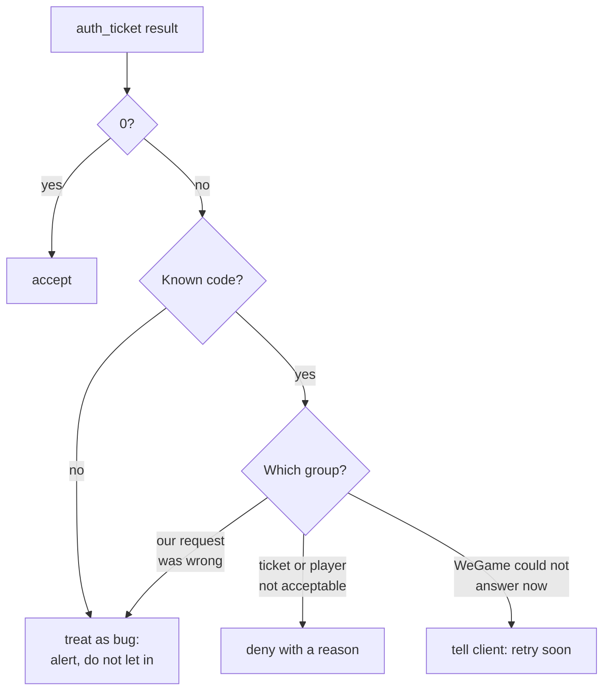

| Group | Codes | Decision |
|---|---|---|
| Valid | `0` | accept |
| Bad ticket | `11501` invalid, `11502` someone else's, `11503` cancelled, `11504` expired, `2150001` `2150006` `2150047` `2150048` malformed | deny: `bad_ticket` |
| Not allowed | `11506` no relation to this game, `11511` no permission | deny: `not_owned` |
| Banned | `11520` ticket owner is banned | deny: `banned` |
| Unsafe | `2150059` abnormal login environment | deny: `unsafe_env` |
| Try again | `11505` game lookup failed, `11508` internal error, `11509` rate limited | retry |
| Our bug | `11500` bad parameters, `11507` body MD5 failed, `2150007` encoding failed | alert, retry |
| Unclear | `11510` has permission, `11512` temporary permission only, anything else | alert; **not** treated as success |

**The one rule: nothing lets a player in except `result 0`.** When WeGame
is down, players wait. This is "fail closed". For login it is the only safe
choice: failing open would let anyone in with any `rail_id`.

`11510` and `11512` sound positive, but the docs do not say when
`auth_ticket` returns them instead of `0`. Treating a code we do not
understand as success would be a hole, so a human decides.

---

## 7. Ownership and bans

A valid ticket proves who the player is. We also check what they may do.

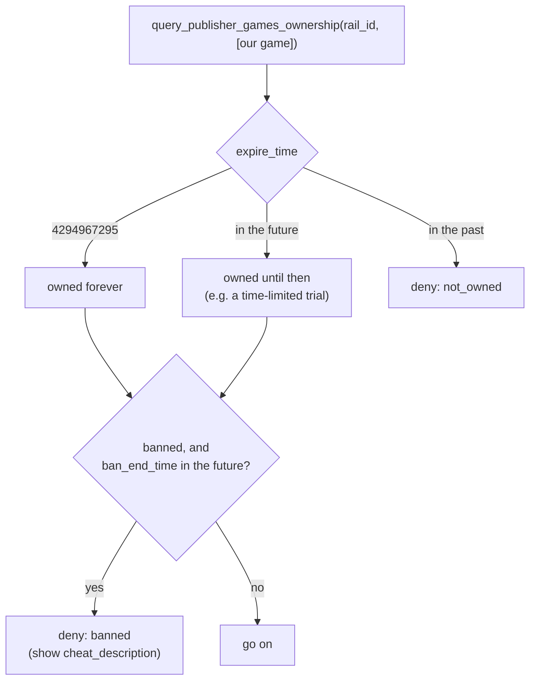

| Endpoint | Gives |
|---|---|
| `GET /web/appstore/ownership/query_game_ownership` | Ownership of our game and its DLCs (`expire_time`, `purchase_time`, `user_dlc_list`) |
| `POST /web/appstore/ownership/query_publisher_games_ownership` | Ownership **and** ban status for up to 50 of the publisher's games, with a ban reason in several languages |

`4294967295` (the largest 32-bit number) is `kRailOwnershipPermanent`:
owned forever.

DLC ownership decides which content to unlock. We read it at login and
whenever the player opens DLC content, because a DLC can be bought while
the game is running.

---

## 8. Our own session

After WeGame says yes, we give the client our own session token and use it
for every later request.

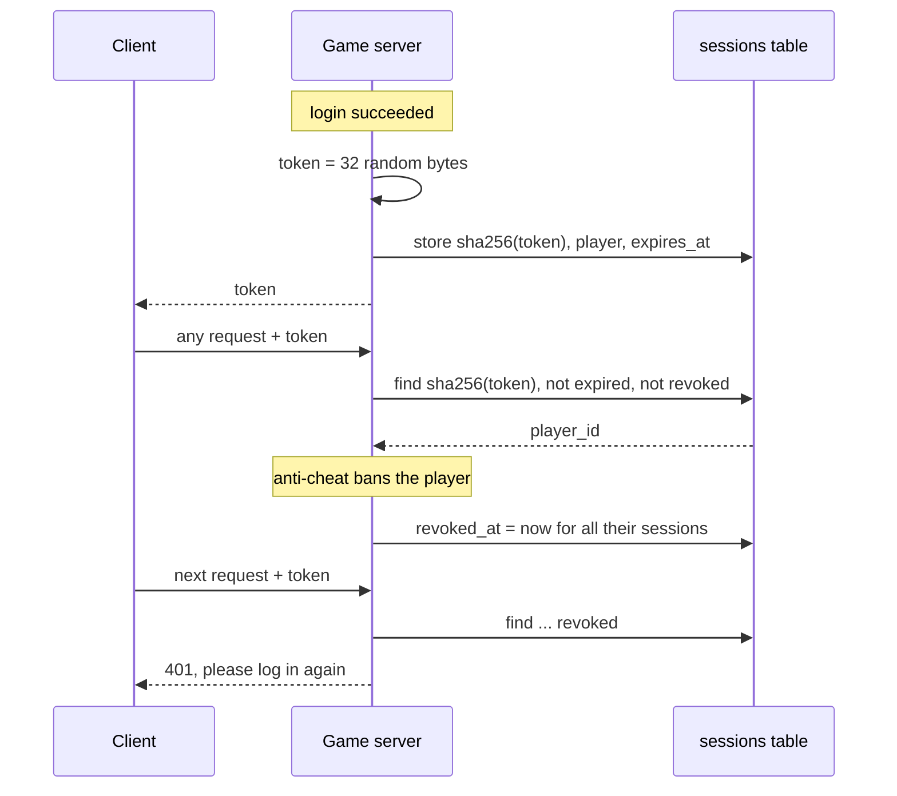

**Why not check the WeGame ticket on every request?**

- A ticket can be checked **only once**.
- `auth_ticket` is rate-limited (`11509`).
- It would add a network call to WeGame to every request.
- We could not cut a player off instantly: we can revoke our own session
  at once, for example right after a ban.

**Why store only a hash?** If the `sessions` table ever leaks, the hashes
cannot be used to log in. The token is random (not a guessable id), so a
plain SHA-256 is enough; no salt is needed.

---

## 9. Database

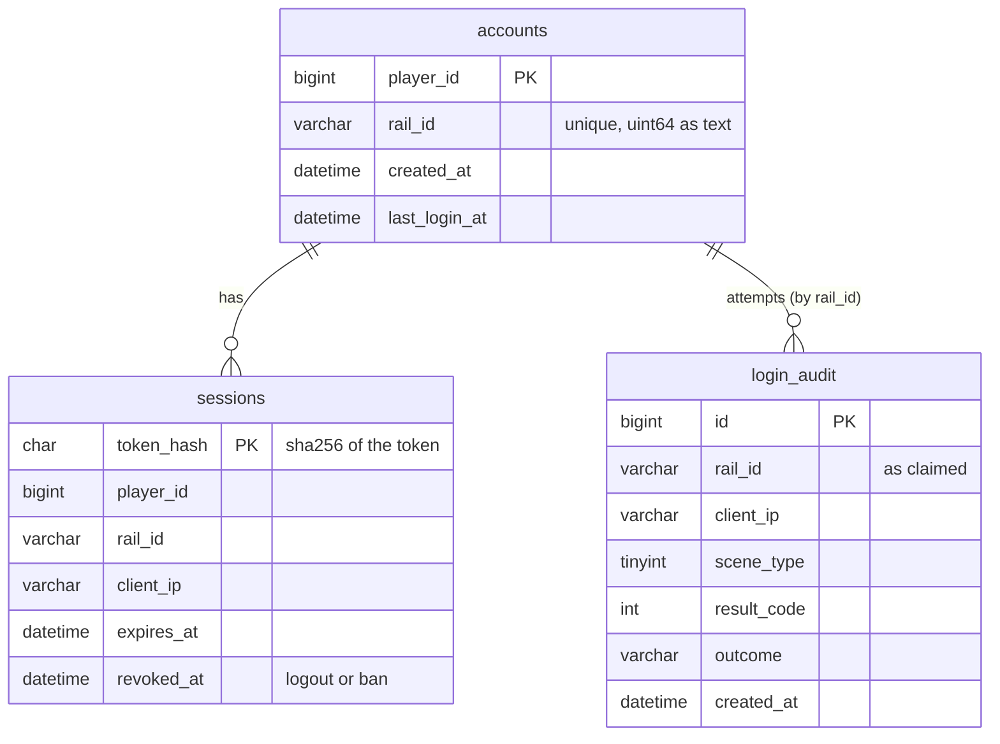

Full SQL: [`sql/schema.sql`](sql/schema.sql).

| Table | Guarantees |
|---|---|
| `accounts` | `UNIQUE (rail_id)`: two first logins at the same moment create one account, not two. We use insert-or-update, never "find, then create". |
| `sessions` | Only hashes are stored. `revoked_at` lets us end sessions at once. |
| `login_audit` | Every attempt, including denied ones, with the WeGame code. Indexed by IP and by `rail_id` for spotting abuse. |

**`rail_id` is stored and handled as text.** It is a 64-bit unsigned
number. JavaScript numbers are exact only up to 2^53, so parsing
`"76561197980265943"` as a number can silently turn it into a different
player's id. The Web API sends it as a string; we keep it that way
everywhere.

**The access_token is not in the database.** It lives in Redis, shared by
all servers:

```
wegame:access_token       → { token, expiresAt, refreshAt }   (TTL = expires_in)
wegame:access_token:lock  → server id                         (SET NX PX 10000)
```

---

## 10. The code

There is no implementation, only definitions with comments that state
exactly what each part must do.

```
sql/
  schema.sql        accounts, sessions, login_audit
src/
  types.ts          RailId, the three tokens, request/response shapes, LoginResult
  errors.ts         AUTH_TICKET_OUTCOMES and HTTP_OUTCOMES: code → decision
  wegame-api.ts     WeGameWebApi: one method per endpoint, HTTP only
  access-token.ts   AccessTokenProvider: shared token, one refresher
  login.ts          LoginService (login steps) and AccountStore (SQL)
```

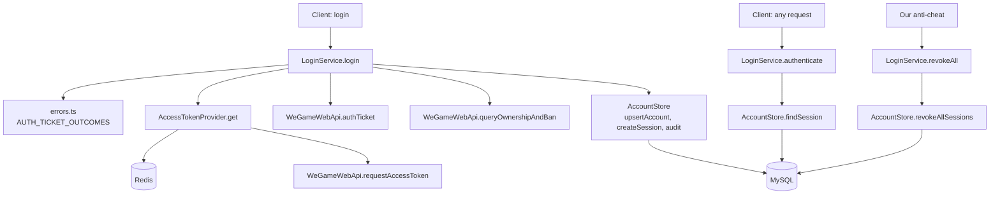

**Reading order:** `types.ts` (the three tokens) → `access-token.ts` (the
trap and its fix) → `login.ts` (the steps) → `errors.ts` (every decision)
→ `wegame-api.ts` and `sql/schema.sql`.

---

## 11. Security rules

- **`client_secret` never leaves our servers.** With it, anyone could call
  the Web API as our game: ban players, add items, read player data.
- **The client's `rail_id` is a claim** until `auth_ticket` returns `0`.
- **Nothing but `result 0` lets a player in.** Unknown codes and outages
  keep the door shut.
- **The IP sent to WeGame is the one we see,** not one the client reports.
- **Rate-limit login** by IP and by `rail_id`.
- **Store only hashes of our session tokens,** and be able to revoke them.
- **Keep `rail_id` as text** end to end.
- **All Web API calls come from our servers.** The docs require it for
  every endpoint used here.

### Related, but handled elsewhere

- **Anti-addiction.** WeGame's SDK enforces play-time limits for minors in
  the client and sends "show tips" / "halt" instructions; payment limits
  are enforced by WeGame's payment tools. The server's part is to save
  progress when a halted player disconnects, which any game server already
  does.
- **Banning cheaters.** The Web API has ban, unban and report endpoints.
  When our anti-cheat bans a player there, we also call `revokeAll` so
  their current session ends now, not at the next login.

---

## 12. Assumptions and limitations

**From the public docs:** both hosts, the token endpoint and its fields,
the 1-hour lifetime and "old token dies within 5 minutes", the bearer
header, every endpoint path and parameter used here, every result code in
`errors.ts`, `scene_type` 1 and 2, single-use tickets,
`kRailOwnershipPermanent = 4294967295`, and the HTTP status table.

**Assumed:**

- **Ban status values.** `player_banned_status.status` uses
  `EnumRailPlayerBanStatus` from the SDK header `rail_web_api_define.h`,
  which is not public. The docs' example shows `status: 2` with
  `ban_end_time: 0` for normal players. This design treats a player as
  banned when `ban_end_time` is in the future; the exact enum must be
  checked against the header.
- **`11510` / `11512` from `auth_ticket`.** Their meaning in a login
  response is not documented, so they are routed to a human.
- **Rate-limit values** for our login endpoint are not given by WeGame.
- **Session length** (12 hours here) is a game design choice.

**Limitations:**

- **Redis is a dependency of login.** If Redis is down, servers cannot
  share the token. A fallback (one server fetching for itself) would bring
  back the trap from section 4, so the design prefers failing closed.
- **No multi-region design.** One Redis per region would mean several
  refreshers, which is the same trap. A real setup needs one token owner
  for the whole game.
- **The deprecated signature method** (`rail_access_key` with HMAC-SHA1)
  is not covered. New games cannot apply for it.
- **Cloud gaming tickets** (`app_ticket/auth_ticket`, JWT) are for cloud
  platforms only; the docs say game developers cannot use that endpoint.

---

## 13. Sources

All pages are on the WeGame developer site
(`developer.wegame.com/developer/game-wiki/help/doc/<page>/zh_CN`):

- [Web API overview](https://developer.wegame.com/developer/game-wiki/help/doc/web-api-api-overview/zh_CN): credentials, access_token, HTTP codes
- [Web API auth example](https://developer.wegame.com/developer/game-wiki/help/doc/web-api-api-example/zh_CN)
- [Validate session ticket (`auth_ticket`)](https://developer.wegame.com/developer/game-wiki/help/doc/web-api-api-reference-session-validate-session-ticket/zh_CN)
- [Web-API availability check (`hello`)](https://developer.wegame.com/developer/game-wiki/help/doc/web-api-api-reference-session-check-web-api-availability/zh_CN)
- [Query game ownership](https://developer.wegame.com/developer/game-wiki/help/doc/web-api-api-reference-user-ownership-check-game-access/zh_CN)
- [Query ownership and ban info](https://developer.wegame.com/developer/game-wiki/help/doc/web-api-api-reference-user-ownership-check-game-access-and-ban-info/zh_CN)
- [SDK: identity authentication](https://developer.wegame.com/developer/game-wiki/help/doc/rail-sdk-helper-typical-usage-authentication-usage/zh_CN)
- [SDK: anti-addiction](https://developer.wegame.com/developer/game-wiki/help/doc/rail-sdk-helper-typical-usage-anti-addiction/zh_CN)
